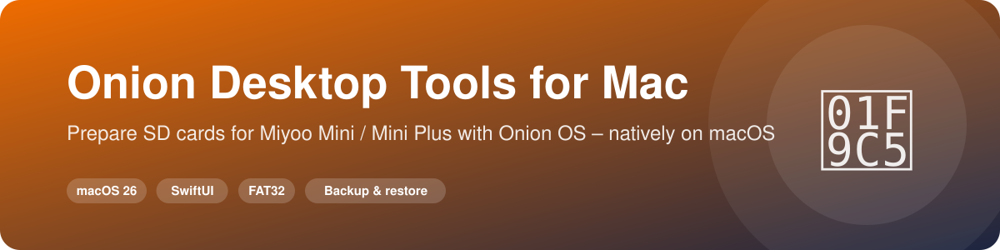
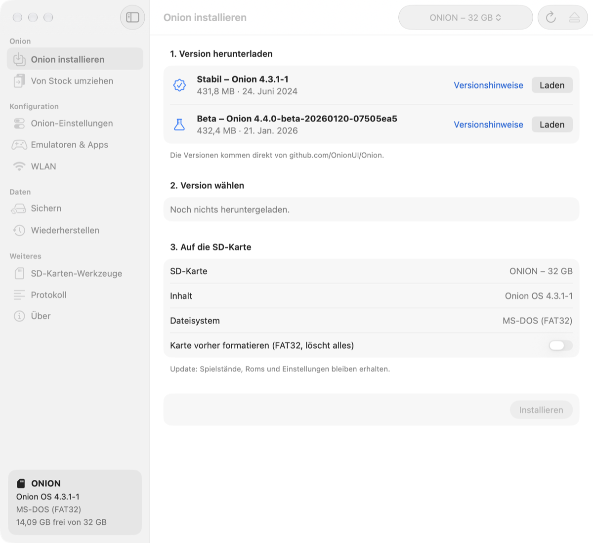
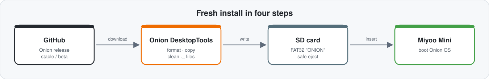
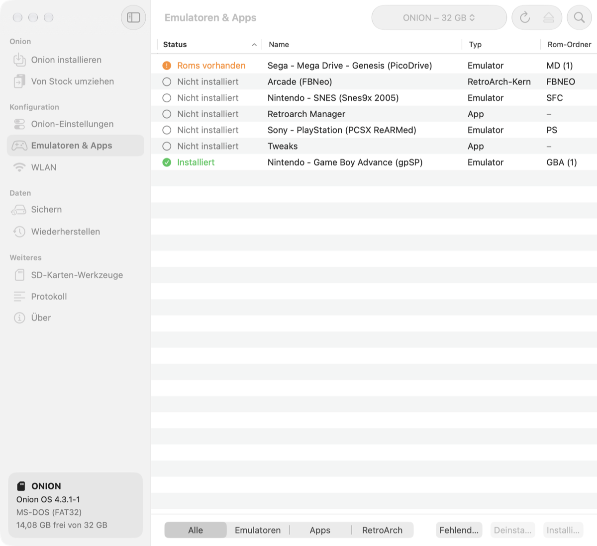
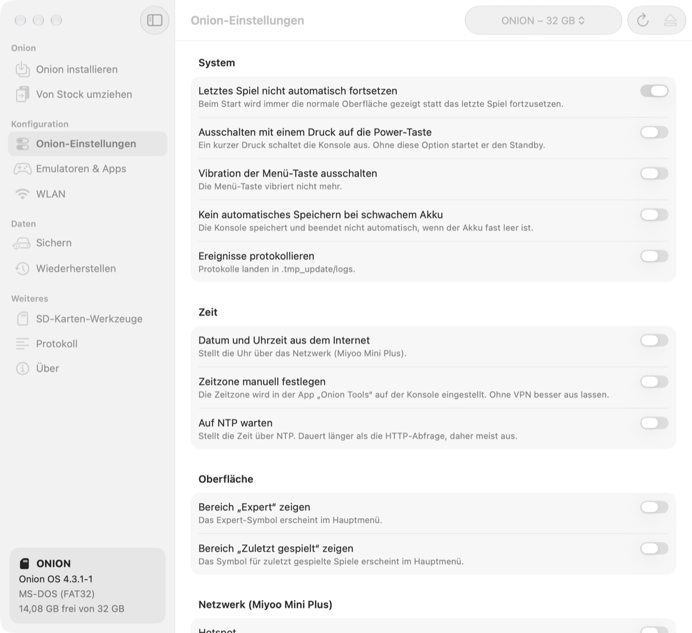
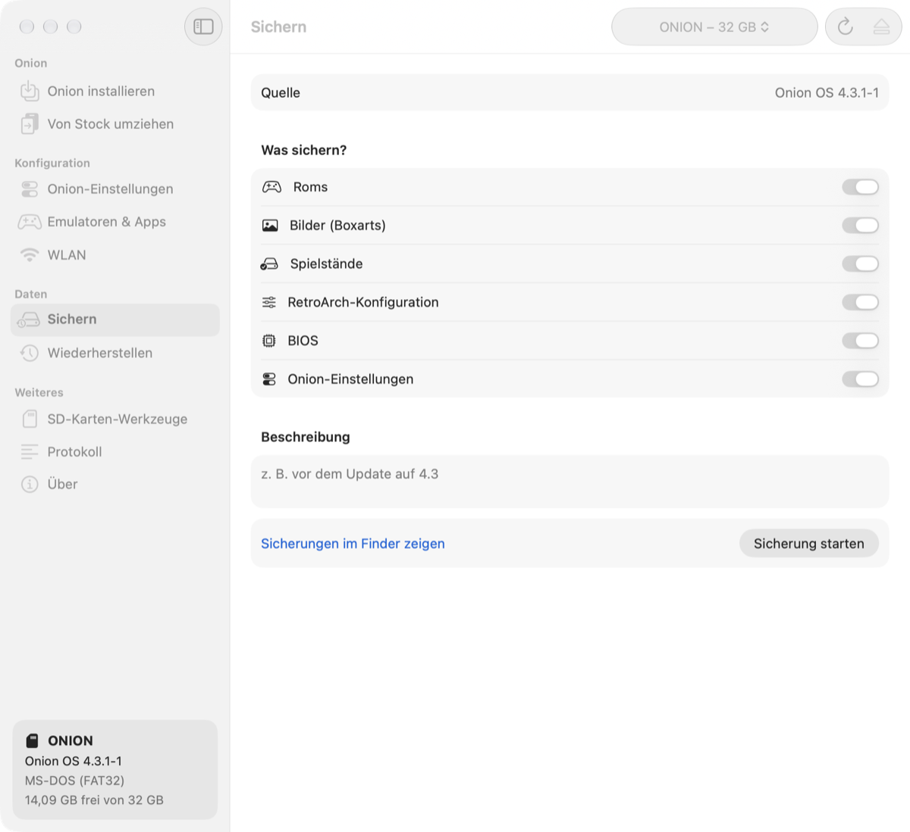
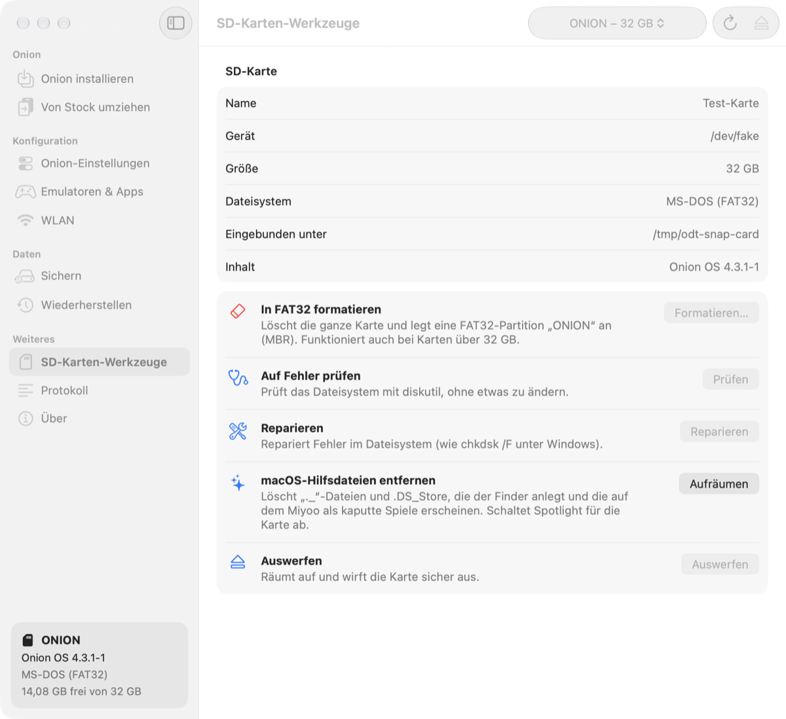
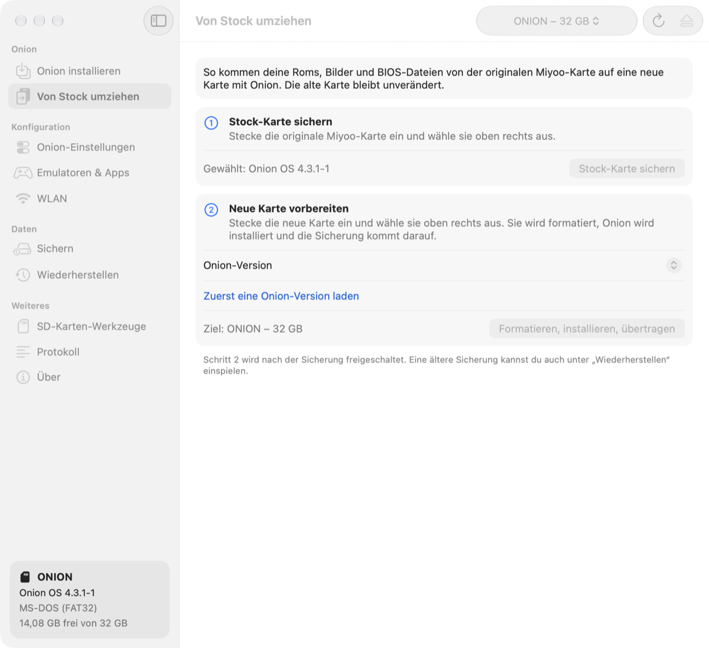
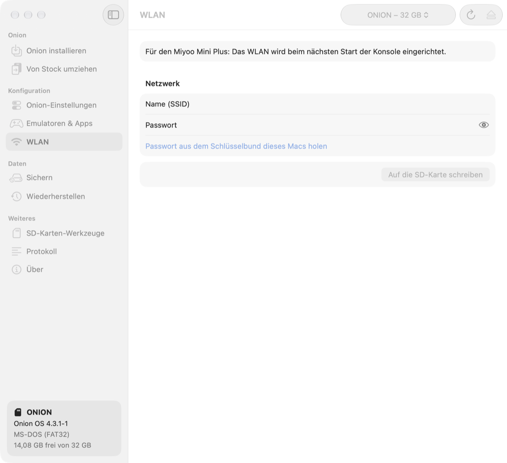

# Onion Desktop Tools für Mac

[English](README.md) · **Deutsch**

[](https://github.com/dr-apple/OnionDesktopTools-Mac/releases/latest)
[](LICENSE)



Native macOS-Umsetzung von [Onion Desktop Tools](https://github.com/schmurtzm/Onion-Desktop-Tools) (Schmurtz, Onion Team).
Bereitet SD-Karten für Miyoo Mini / Miyoo Mini Plus mit [Onion OS](https://github.com/OnionUI/Onion) vor.

<picture>
  <source media="(prefers-color-scheme: dark)" srcset="docs/images/install-dark.png">
  
</picture>

## Funktionen

- Onion (stabil oder Beta) direkt von GitHub laden und auf die Karte entpacken – Neuinstallation oder Update
- SD-Karte in FAT32 formatieren (`diskutil eraseDisk FAT32 ONION MBRFormat`), auch über 32 GB
- Dateisystem prüfen und reparieren (statt chkdsk)
- Sichern und Wiederherstellen: Roms, Bilder, Spielstände, BIOS, RetroArch-Konfiguration, Onion-Einstellungen
- Umzug von der Miyoo-Stock-Karte auf eine neue Onion-Karte (geführt)
- Onion-Einstellungen (Marker-Dateien in `.tmp_update/config`) umschalten
- Emulatoren- und App-Manager (Paketmanager von Onion), inkl. „Fehlende installieren“
- WLAN für den Miyoo Mini Plus einrichten, Passwort optional aus dem Schlüsselbund
- Mac-spezifisch: entfernt „._“-Dateien und .DS_Store, schaltet Spotlight für die Karte ab, sicheres Auswerfen



## Installieren

1. Unter [Releases](https://github.com/dr-apple/OnionDesktopTools-Mac/releases) die neueste
   `OnionDesktopTools-x.y.z.zip` laden und entpacken. Läuft auf Apple-Silicon- und Intel-Macs mit macOS 26.
2. `OnionDesktopTools.app` in den Ordner „Programme“ ziehen.
3. Die App ist nicht von Apple beglaubigt (notarisiert). Beim ersten Öffnen meldet macOS, dass sie nicht
   geprüft werden kann. Dann: **Systemeinstellungen › Datenschutz & Sicherheit › „Dennoch öffnen“**.
   Alternativ im Terminal:

   ```bash
   xattr -dr com.apple.quarantine /Applications/OnionDesktopTools.app
   ```

Ab Version 0.2.0 sucht die App selbst nach Updates und installiert sie auf Wunsch (Einstellungen › Updates
oder Menü „Onion Desktop Tools › Nach Updates suchen …“). Von 0.1.0 musst du einmal von Hand aktualisieren.

> **Frühe Version.** Formatieren und Auswerfen sind bisher nur mit Disk-Images getestet, nicht mit
> echten SD-Karten. Vor dem Formatieren prüft die App, dass es eine Wechselkarte ist, und fragt nach.
> Sichere wichtige Spielstände trotzdem vorher.

## Anleitung: neue Karte mit Onion

1. SD-Karte in den Mac stecken – sie erscheint oben rechts in der Kartenauswahl und unten links mit Inhalt und freiem Platz.
2. **Onion installieren** → bei *Stabil* auf **Laden** klicken.
3. Unter *2. Version wählen* die geladene Version wählen.
4. Bei einer neuen oder fremden Karte **Karte vorher formatieren (FAT32, löscht alles)** einschalten. Für ein Update ausgeschaltet lassen – Spielstände, Roms und Einstellungen bleiben dann erhalten.
5. **Installieren** – danach räumt die App die Mac-Dateien auf und wirft die Karte sicher aus.
6. Karte in den Miyoo Mini stecken und einschalten; Onion richtet sich beim ersten Start ein.

## Weitere Seiten

| Emulatoren & Apps | Onion-Einstellungen |
|---|---|
| <picture>
  <source media="(prefers-color-scheme: dark)" srcset="docs/images/packages-dark.png">
  
</picture> | <picture>
  <source media="(prefers-color-scheme: dark)" srcset="docs/images/onionSettings-dark.png">
  
</picture> |
| **Sichern** | **SD-Karten-Werkzeuge** |
| <picture>
  <source media="(prefers-color-scheme: dark)" srcset="docs/images/backup-dark.png">
  
</picture> | <picture>
  <source media="(prefers-color-scheme: dark)" srcset="docs/images/tools-dark.png">
  
</picture> |
| **Von Stock umziehen** | **WLAN (Miyoo Mini Plus)** |
| <picture>
  <source media="(prefers-color-scheme: dark)" srcset="docs/images/migrate-dark.png">
  
</picture> | <picture>
  <source media="(prefers-color-scheme: dark)" srcset="docs/images/wifi-dark.png">
  
</picture> |

*Echte Screenshots der App mit einer Test-Karte (helles bzw. dunkles Erscheinungsbild je nach System).*

## Fehlersuche

| Problem | Lösung |
|---|---|
| „App kann nicht geöffnet werden“ | Systemeinstellungen › Datenschutz & Sicherheit › „Dennoch öffnen“ oder `xattr`-Befehl oben. |
| Karte erscheint nicht | Aktualisieren-Knopf oben rechts; prüfen, ob die Karte im Finder auftaucht. |
| Miyoo zeigt nach dem Kopieren Fehler | Unter *SD-Karten-Werkzeuge* das Dateisystem prüfen und „._“-Dateien entfernen lassen. |
| Was ist passiert? | Seite **Protokoll** zeigt jeden Schritt und jeden ausgeführten Befehl. |

## Bauen

Voraussetzungen: macOS 26, Swift 6.2 (Xcode Command Line Tools).

```bash
./build.sh --open
```

Die App landet in `~/Applications/OnionDesktopTools.app`. Downloads und Sicherungen liegen in
`~/Library/Application Support/OnionDesktopTools`. Beide Ordner lassen sich in den Einstellungen ändern.

Release bauen: `tools/release.sh 0.1.0` (Universal-App, ad hoc signiert, Zip in `dist/`).

Tests: `swift test --scratch-path ~/Library/Developer/OnionDesktopTools/test-build` und `tools/selftest.sh`.
Screenshots aller Seiten mit Test-Karte: `tools/snap.sh`.

## Lizenz und Dank

Dieses Projekt ist eine Mac-Umsetzung von [Onion Desktop Tools](https://github.com/schmurtzm/Onion-Desktop-Tools)
von Schmurtz und steht wie das Original unter der [GNU GPL v3](LICENSE).
Onion OS stammt vom [Onion-Team](https://github.com/OnionUI/Onion).
