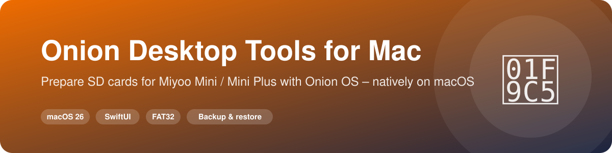
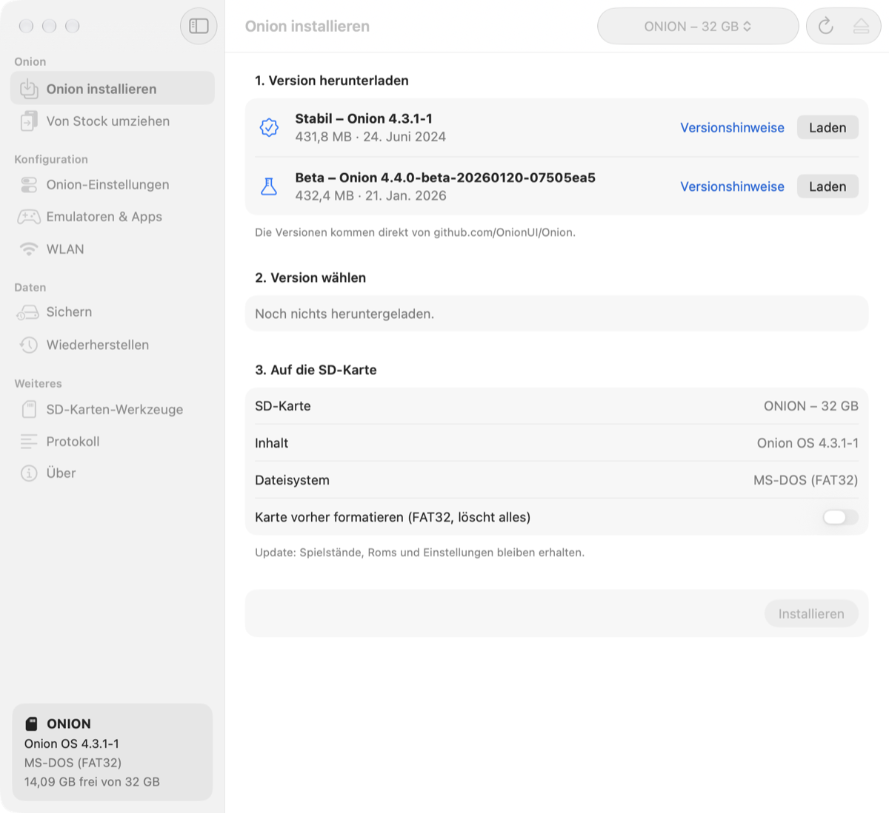
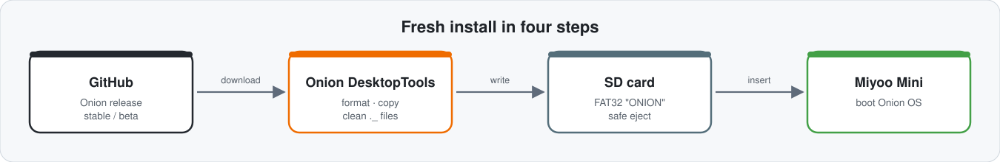
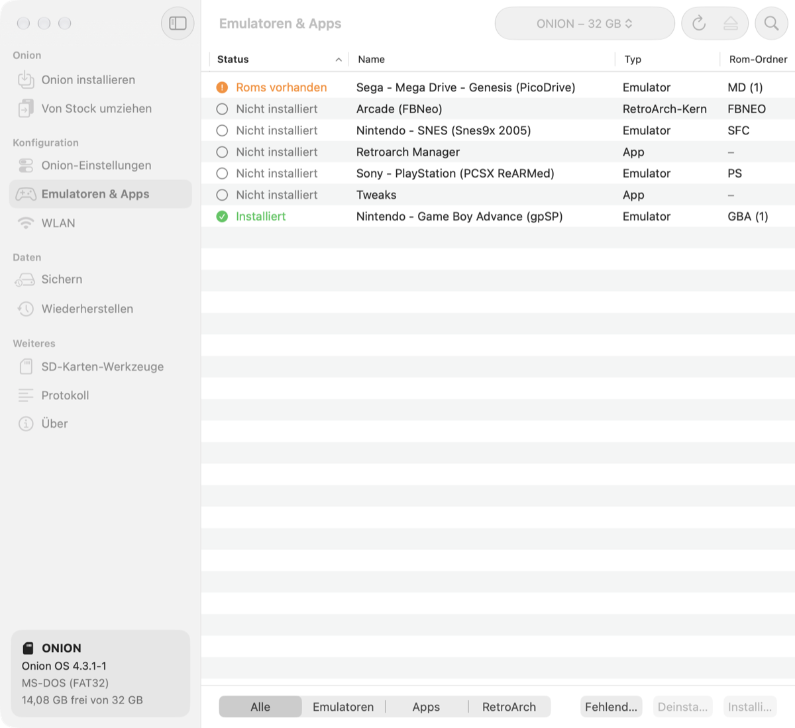
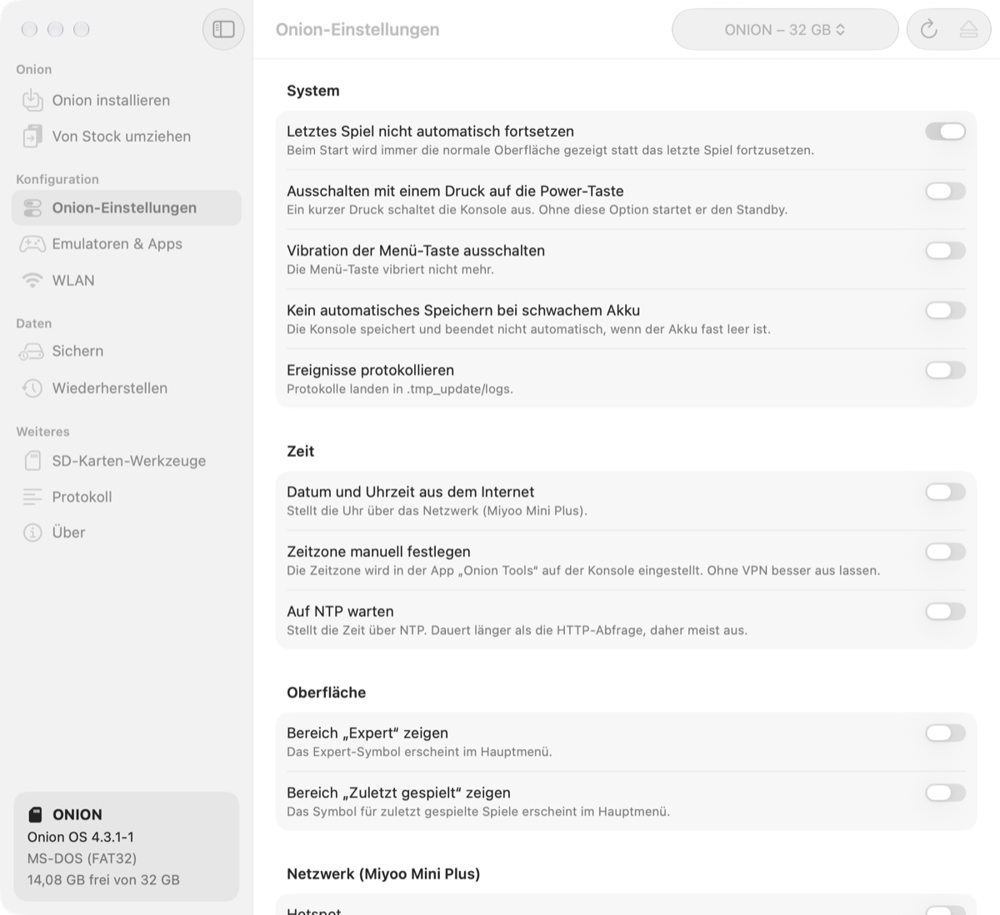
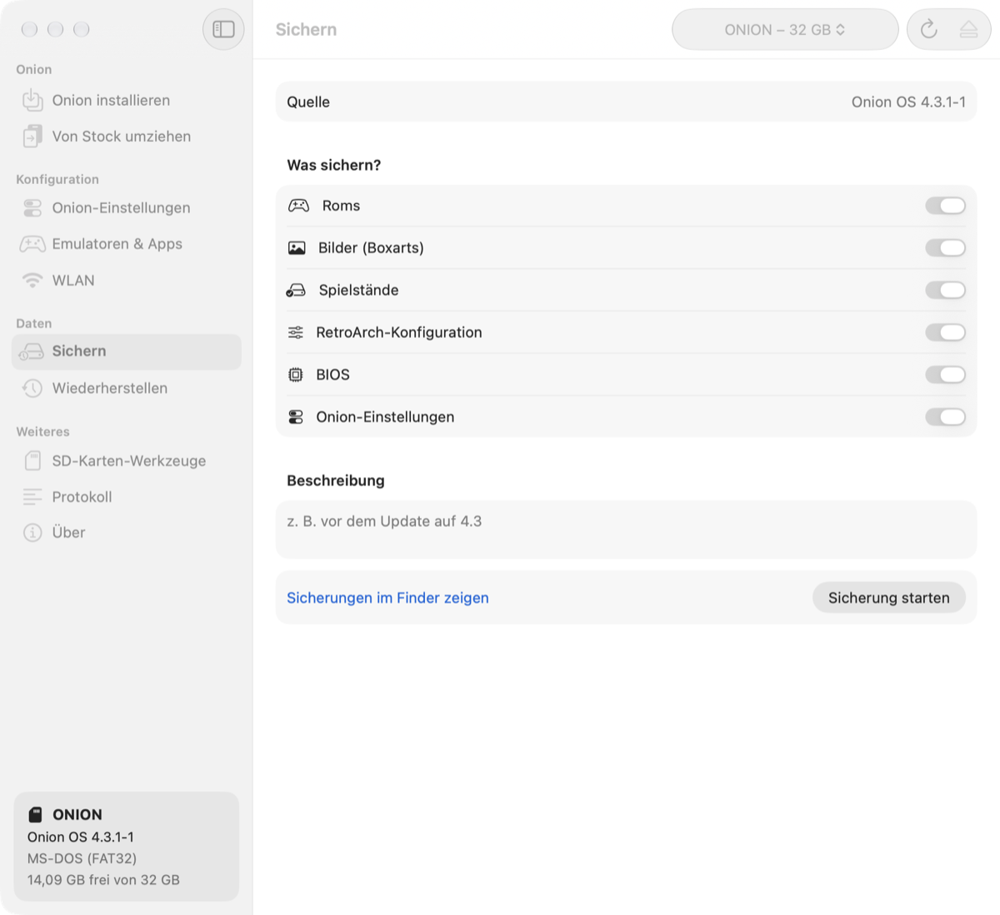
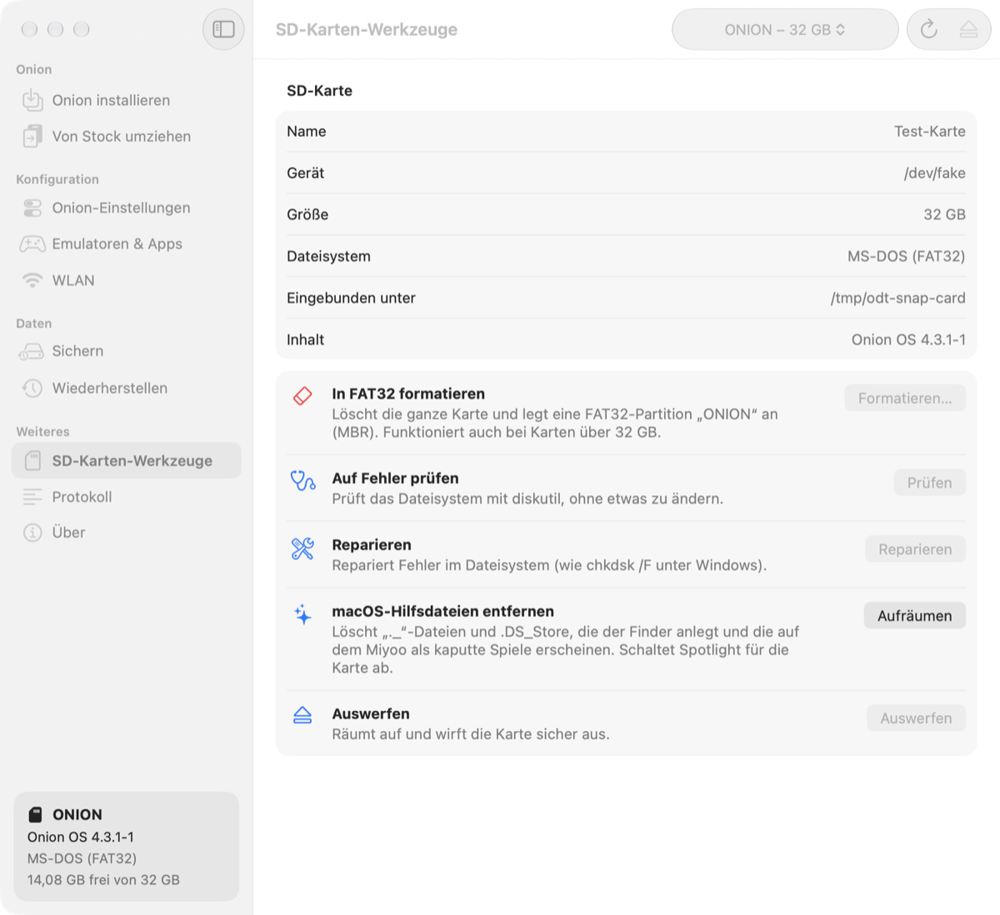
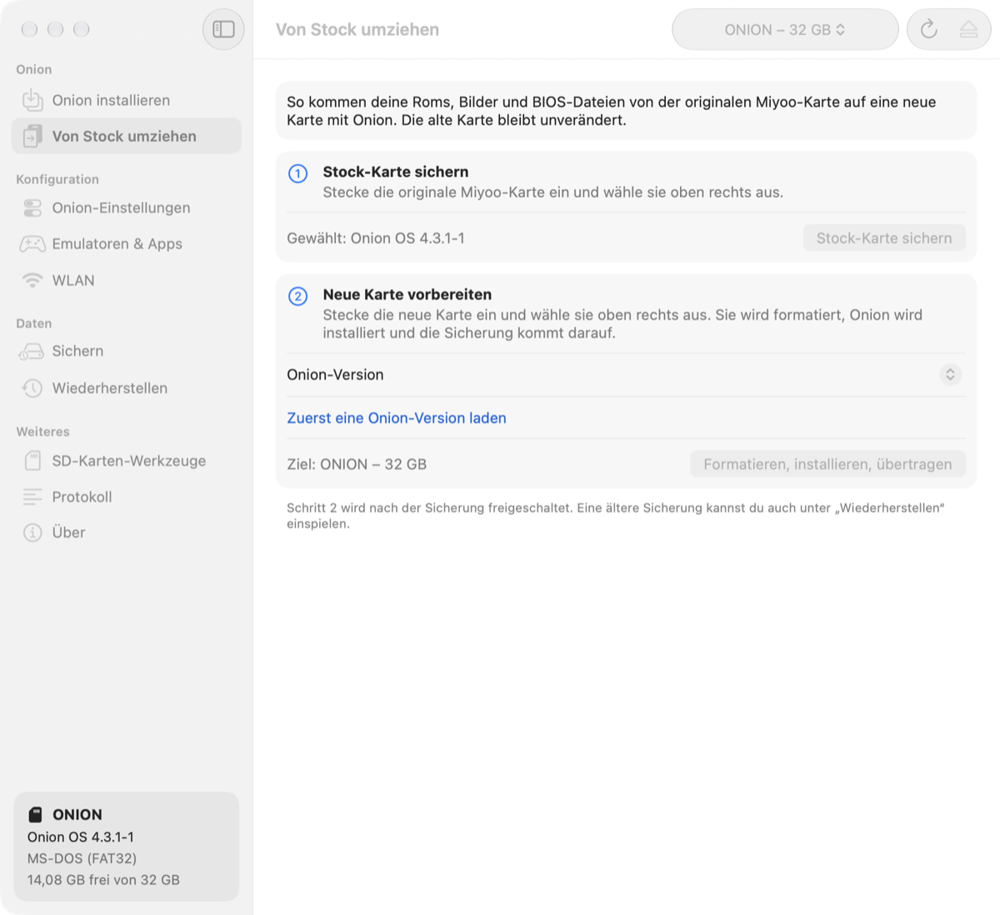
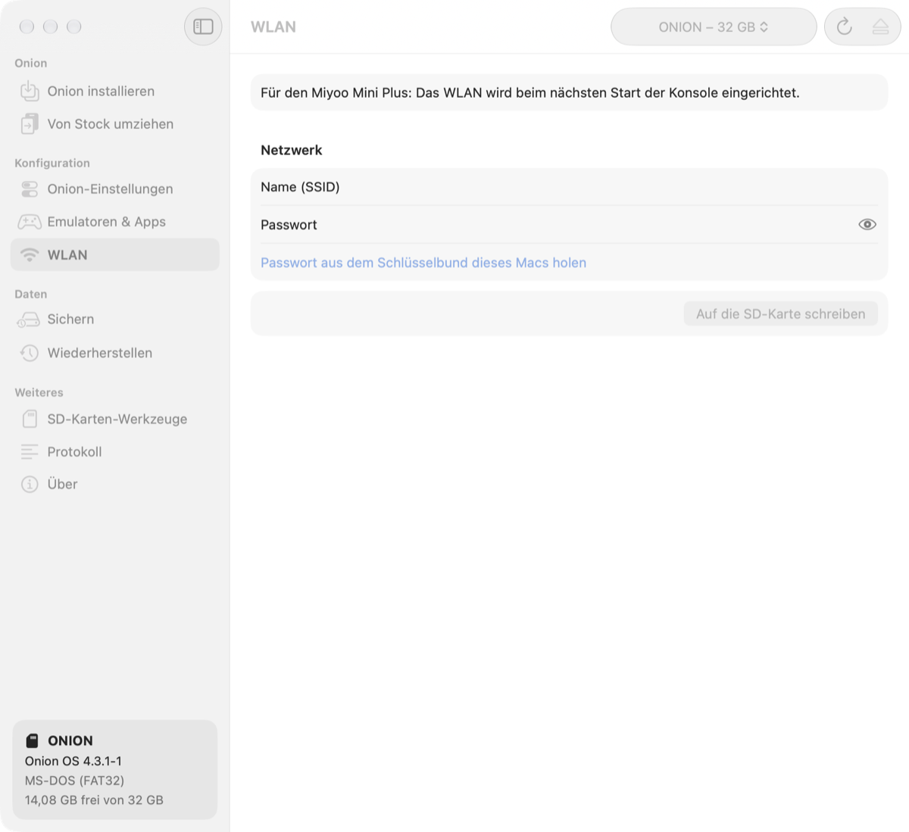

# Onion Desktop Tools for Mac

**English** · [Deutsch](README.de.md)

[](https://github.com/dr-apple/OnionDesktopTools-Mac/releases/latest)
[](LICENSE)



A native macOS port of [Onion Desktop Tools](https://github.com/schmurtzm/Onion-Desktop-Tools) (Schmurtz, Onion Team).
It prepares SD cards for the Miyoo Mini / Miyoo Mini Plus with [Onion OS](https://github.com/OnionUI/Onion).

> The app's user interface is German. The screenshots below show it with a test card.

<picture>
  <source media="(prefers-color-scheme: dark)" srcset="docs/images/install-dark.png">
  
</picture>

## Features

- Download Onion (stable or beta) straight from GitHub and unpack it onto the card – fresh install or update
- Format the SD card as FAT32 (`diskutil eraseDisk FAT32 ONION MBRFormat`), also above 32 GB
- Check and repair the file system (instead of chkdsk)
- Back up and restore: roms, images, saves, BIOS, RetroArch configuration, Onion settings
- Guided move from the Miyoo stock card to a new Onion card
- Toggle Onion settings (marker files in `.tmp_update/config`)
- Emulator and app manager (Onion's package manager), incl. "install missing"
- Set up Wi-Fi for the Miyoo Mini Plus, password optionally from the Keychain
- Mac specifics: removes "._" files and .DS_Store, turns off Spotlight for the card, safe eject



## Install

1. Download the latest `OnionDesktopTools-x.y.z.zip` from [Releases](https://github.com/dr-apple/OnionDesktopTools-Mac/releases) and unzip it. Runs on Apple silicon and Intel Macs with macOS 26.
2. Drag `OnionDesktopTools.app` to *Applications*.
3. The app is not notarized by Apple. On first launch macOS says it can't be verified. Then: **System Settings › Privacy & Security › "Open Anyway"**. Or in Terminal:

   ```bash
   xattr -dr com.apple.quarantine /Applications/OnionDesktopTools.app
   ```

From version 0.2.0 the app checks for updates itself and installs them on request (Settings › Updates or menu "Onion Desktop Tools › Check for updates …"). Coming from 0.1.0 you need to update by hand once.

> **Early version.** Formatting and ejecting have only been tested with disk images so far, not with real SD cards. Before formatting, the app checks that it is a removable card and asks for confirmation. Back up important saves anyway.

## Walkthrough: a new card with Onion

1. Insert the SD card – it appears in the card picker at the top right and bottom left with its content and free space.
2. **Onion installieren** (install Onion) → click **Laden** (download) next to *Stabil* (stable).
3. Under *2. Version wählen* pick the downloaded version.
4. For a new or foreign card turn on **Karte vorher formatieren (FAT32, löscht alles)** (format first, erases everything). Leave it off for an update – saves, roms and settings are kept.
5. **Installieren** – afterwards the app cleans up the Mac files and ejects the card safely.
6. Put the card into the Miyoo Mini and switch it on; Onion finishes its setup on first boot.

## More pages

| Emulators & apps | Onion settings |
|---|---|
| <picture>
  <source media="(prefers-color-scheme: dark)" srcset="docs/images/packages-dark.png">
  
</picture> | <picture>
  <source media="(prefers-color-scheme: dark)" srcset="docs/images/onionSettings-dark.png">
  
</picture> |
| **Back up** | **SD card tools** |
| <picture>
  <source media="(prefers-color-scheme: dark)" srcset="docs/images/backup-dark.png">
  
</picture> | <picture>
  <source media="(prefers-color-scheme: dark)" srcset="docs/images/tools-dark.png">
  
</picture> |
| **Move from stock** | **Wi-Fi (Miyoo Mini Plus)** |
| <picture>
  <source media="(prefers-color-scheme: dark)" srcset="docs/images/migrate-dark.png">
  
</picture> | <picture>
  <source media="(prefers-color-scheme: dark)" srcset="docs/images/wifi-dark.png">
  
</picture> |

*Real screenshots of the app with a test card (light or dark appearance follows your system).*

## Troubleshooting

| Problem | Fix |
|---|---|
| "App can't be opened" | System Settings › Privacy & Security › "Open Anyway", or the `xattr` command above. |
| Card doesn't show up | Refresh button at the top right; check that the card appears in Finder. |
| Miyoo shows errors after copying | Under *SD-Karten-Werkzeuge* check the file system and remove "._" files. |
| What happened? | The **Protokoll** (log) page lists every step and every command run. |

## Build

Requirements: macOS 26, Swift 6.2 (Xcode Command Line Tools).

```bash
./build.sh --open
```

The app goes to `~/Applications/OnionDesktopTools.app`. Downloads and backups live in `~/Library/Application Support/OnionDesktopTools`; both folders can be changed in Settings.

Release build: `tools/release.sh 0.1.0` (universal app, ad-hoc signed, zip in `dist/`).

Tests: `swift test --scratch-path ~/Library/Developer/OnionDesktopTools/test-build` and `tools/selftest.sh`.
Screenshots of every page with a test card: `tools/snap.sh`.

## License and thanks

This project is a Mac port of [Onion Desktop Tools](https://github.com/schmurtzm/Onion-Desktop-Tools) by Schmurtz and, like the original, licensed under the [GNU GPL v3](LICENSE).
Onion OS is made by the [Onion team](https://github.com/OnionUI/Onion).
